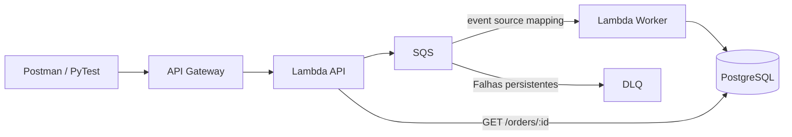

# Treinamento de testes de backend

Laboratório local para cinco aulas de uma hora. **LocalStack** emula API Gateway, Lambda, SQS, IAM e Logs. **PostgreSQL em Docker** representa o banco que seria hospedado no RDS.



## Iniciar

Para preparar uma máquina do zero, siga o [guia completo de instalação](docs/instalacao.md): Windows/WSL 2, Docker, Git, criação de conta e token LocalStack, Postman, banco e dependências Python.

O guia também inclui a [instalação do Python 3.13 no Windows](docs/instalacao.md#12-instalar-python-313-pip-e-ambiente-virtual-no-windows), com configuração do PATH, pip e ambiente virtual.

Pré-requisitos: Docker Desktop com engine Linux ativo, Docker Compose e licença LocalStack com os serviços usados pelo projeto.

Copie `.env.example` para `.env` na raiz, se ainda não houver esse arquivo, e preencha seu token:

```dotenv
LOCALSTACK_AUTH_TOKEN=SEU_TOKEN
```

```powershell
docker compose up --build -d
docker compose logs -f provision
```

O provisionador deve encerrar com código **0**. Depois, confirme a saúde da aplicação:

```powershell
$labConfig = Get-Content .local/manifest.json | ConvertFrom-Json
Invoke-RestMethod "$($labConfig.base_url)/health"
```

Esperado: `status = ok`. As URLs são geradas em `.local/manifest.json` e podem mudar ao recriar o LocalStack.

## Usar a API

Importe no Postman `postman/treinamento.postman_collection.json` e o ambiente `.local/postman.local.json`. Selecione **Treinamento local**.

| Requisição | Resultado |
|---|---|
| `GET /health` | 200 quando banco e fila respondem |
| `POST /orders` | 202 após publicar na fila |
| `GET /orders/{order_id}` | 200 após persistência ou 404 se ainda não encontrado |

```json
{
  "order_id": "550e8400-e29b-41d4-a716-446655440000",
  "customer_id": "aluno-01",
  "amount": "42.50",
  "currency": "BRL"
}
```

Use um UUID novo para cada pedido. `customer_id` aceita de 1 a 100 caracteres, com algum caractere além de espaços. O valor deve ser positivo, com até duas casas decimais. A moeda é BRL e campos extras são rejeitados. Entradas inválidas retornam 400; payload acima de 64 KiB, 413; dependência indisponível, 503.

**202 comprova envio à fila, não persistência.** O banco contém somente pedidos processados. Reenviar o mesmo ID e os mesmos dados preserva um único pedido.

## Testes

```powershell
# Suíte completa; retries e DLQ podem levar alguns minutos.
docker compose --profile test run --rm tests

# Filtrar por abordagem: unit, contract, integration ou resilience.
docker compose --profile test run --rm tests python -m pytest -m unit -v
```

A suíte completa salva `reports/pytest.xml`. Testes funcionais exigem provisionamento concluído e Worker ativo.

## Documentação

| Documento | Uso |
|---|---|
| [Instalação completa](docs/instalacao.md) | Ferramentas, dependências, conta LocalStack, configuração e validação do ambiente |
| [Acompanhar o fluxo](docs/acompanhar-fluxo.md) | Filas, logs, SQL, falhas, recuperação e manutenção |
| [Plano das aulas](docs/plano-de-aulas.md) | Objetivos, tempos e entregas dos cinco encontros |
| [Aula 1](docs/aula-01.md) | Resumo teórico, apresentação e fontes AWS |
| [Postman](postman/README.md) | Pastas, variáveis e execução da coleção |

O laboratório tem portas locais e credenciais descartáveis. Não provisiona RDS gerenciado nem valida rede, escala ou permissões efetivas da AWS. O provisionador aceita somente endpoints locais.
